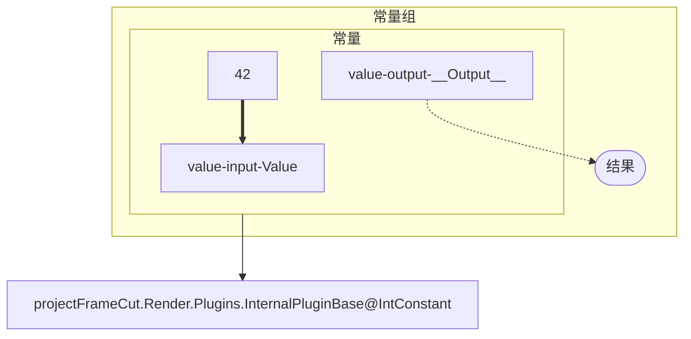

# Effect 组 Mermaid 文件

Effect 组库使用 UTF-8 `.mmd` 文件。通过设置中的 Effect 组库导入，在绑定编辑器中添加组；画布中的组保存、导出以及组库导出均使用此格式。旧 JSON 组文件不再加载或迁移。

绑定编辑器顶部的导入按钮可选择 `.mmd` 文件，也可粘贴或直接编辑 Mermaid 文本。导入后追加为新组合，保留现有管线，支持编辑器撤销；格式、插件或阶段不兼容时显示错误并保留输入文本。

菜单中的“图”使用相同的 Mermaid 编解码器生成当前阶段、当前管线的诊断视图，包含节点类型、静态值、嵌套组、Clip 属性、已显示的源和最终输出。诊断视图带有 `@graph.Diagnostic: true`，保留项目上下文；手动导入使用可复用组模板，组模板通过组的导出操作获得。

可直接导入的例子：[effect-group-sincos.mmd](examples/effect-group-sincos.mmd)。它把内置进度传给 SinCos，再取两个输出的最大值，包含嵌套组、公开接口及静态参数。

## 简写

在 `graph TD` 后、所有 subgraph 之前，用 `<Node ID> --> NodeDef<Node ID>["<FromPlugin>@<EffectTypeName>"]` 声明节点类型。`NodeDef` 的 ID 必须唯一，也不能与图中其他声明重复。这种连线只声明类型，不产生运行时绑定。



类型已用 `NodeDef` 声明后，`@provider` 只需保存静态参数、阶段等附加配置，也可以完全省略。端口声明可只写 ID：

| ID 格式 | 含义 |
| --- | --- |
| `<Node>-input-<Field>` | 输入端口 |
| `<Node>-param-<Field>`、`<Node>-parameter-<Field>` | 参数输入，与 `input` 等价 |
| `<Node>-output-<Field>` | 输出端口 |
| `<Node>-__Input__`、`<Node>-__Output__` | 对应保留字段的简写 |

方向关键字不区分大小写；节点和字段 ID 区分大小写。按端口所在 subgraph 的完整 ID 匹配前缀，剩余字段 ID 中的连字符会保留。省略显示名称时，导入后的端口名称使用字段 ID；在 Mermaid 渲染器中，裸节点会显示完整 ID。仍可写 `node-input-A["输入 A"]` 自定义显示文字。

组内符合上述格式的端点自动识别为组公开接口，不需要 `@interface`。没有类型声明的 subgraph 自动识别为组，不需要 `@group`。只有一个顶层组时可以省略 `@graph`，阶段默认为 `Render`；也可用 `%% @graph {"Root":"group","Stage":"Composition"}` 指定默认阶段，单个 provider 的 `Stage` 可覆盖默认值。内置源仍用 `@source` 声明。

保留原来的完整 JSON 元数据写法；无法通过 ID 表达的字段可使用 `@port`。同一节点同时使用 `NodeDef` 和 JSON 类型声明时，类型与插件必须一致。

## 图上的静态值与枚举配置

静态值用所属 provider 内的 `<Node>-value-<Field>["JSON 字面量"]` 节点声明，`==>` 粗箭头把值关联到对应输入端口。导出会显示所有保存的静态值，包括已绑定端口的静态回退值。

```text
node3-value-B["67"]
node3-value-Operation["#34;#60;#34;"]
```

上面的值节点放在 `node3` 的 subgraph 内，在连线区写：

```text
node3-value-B ==> node3-input-B
node3-value-Operation ==> node3-input-Operation
```

第二个节点的值是 JSON 字符串 `"<"`，渲染后能看到实际选中的比较方式。字符串的双引号使用 `#34;`，小于号使用 `#60;`；数值、布尔值、`null`、数组和对象同样按 JSON 表示。值节点必须显式提供标签，不能只写裸 ID。

值节点本身就声明静态字段；粗箭头可省略，仅用于直观关联同一个 provider 的对应输入。它不创建动态绑定，也不解除已有绑定。一个字段只能有一个值节点，普通 `-->` 不能用来连接值节点。

`%% @provider {"Id":"node3","StaticFields":{"B":67,"Operation":"<"}}` 的原始声明仍然有效，适用于 NodeDef 简写和完整 JSON 类型声明两种语法。同一个字段同时在注释和图上声明时必须具有相同的 JSON 值。导出默认将静态字段放到图上；阶段、启用状态及其他元数据继续保留在注释中。

字段 ID 无法直接写进 Mermaid 标识符时，可使用 `%% @value {"Id":"custom-value","Node":"node3","Field":"真实字段键"}`，再声明 `custom-value["JSON 字面量"]`。

PowerShell 已连接项目时，也可直接导入文件：

```powershell
Import-ProjectClipEffectGroup -ClipId $clipId -TemplateMermaid (Get-Content ./effect-group.mmd -Raw)
Export-ProjectClipEffectGroup -ClipId $clipId -GroupId $groupId | Set-Content ./effect-group.mmd -Encoding utf8
```

RPC 的 `ImportClipEffectGroup` 同样使用 `TemplateMermaid` 参数，组库查询结果通过 `TemplateMermaid` 返回源码。

## 声明与连线

文件必须包含下面的头部，版本号为此文件格式的版本；`@graph` 可按上述规则省略：

```mermaid
%% projectFrameCut Effect Binding Graph
%% Version 1
%% @graph {"Root":"my-group"}
graph TD
```

先声明全部 subgraph、端口、静态值及组接口，关闭全部 subgraph 后再写连线。`-->` 是实际数据绑定，`-.->` 是公开接口映射，`==>` 是静态值关联。一行一条语句，可带行末分号。支持空行和 `%%` 注释。不支持 Mermaid 的样式、链式连线、边标签、其他节点形状和方向声明。

别名区分大小写，格式为 `[A-Za-z_][A-Za-z0-9_-]*`，在整个文件中唯一；不要使用 Mermaid 保留字 `end`。`subgraph alias["名称"]` 声明组、provider 或内置源，也可省略名称写成 `subgraph alias`；`alias["名称"]` 或裸 `alias` 声明节点端口；`alias(["名称"])` 声明圆角的组接口端点。节点运行时 GUID 在导入时生成。

名称中的特殊字符使用 Mermaid 十进制实体：`#34;` 是双引号、`#35;` 是井号、`#38;` 是 `&`、`#60;` 是 `<`、`#62;` 是 `>`、`#10;` 是换行。导出会自动转义。实体只解码一次。

## 变量

每个 `EffectVariableRead`、`EffectVariableWrite` 节点必须在自己的 subgraph 内声明一条 `%% @variable <ID>`：

```text
subgraph read["读取计数"]
    %% @variable counter
    read-input-InitialValue
    read-output-__Output__
end
subgraph write["写入计数"]
    %% @variable counter
    write-input-__Input__
end
```

ID 是去掉首尾空白后的单行文本，区分大小写，可以使用任意非空字符串。整个图（包括嵌套组）中，相同 ID 表示同一个变量，不同变量必须使用不同 ID；同一变量的节点必须使用相同的类型和阶段。导入时为每个 ID 创建实际的变量，每次实例化都会分配新的内部 ID。

导出按实际变量关系生成 `variable1`、`variable2` 等图内唯一的 ID，所有变量节点都写出标注，`MetaData.VariableId` 不再写入文件。导入以 `@variable` 标注为准；缺少、重复或放错位置会报告行号，旧文件也需要补齐标注。

## 结构化注释

除上述 `@variable` 外，元数据使用单行 `%% @类型 {JSON}`，属性名区分大小写，未知属性或未知元数据类型会报错。可推断的声明无需元数据；需要元数据时，放在对应声明之前便于阅读。元数据必须位于实际连线阶段之前。

| 注释 | 必需字段 | 可选字段及默认值 |
| --- | --- | --- |
| `@graph` | `Root`：根组别名 | `Stage: "Render"`；全文件最多一条 |
| `@group` | `Id`：组别名 | `Collapsed: true`、`X: 0`、`Y: 0` |
| `@provider` | `Id`；没有 NodeDef 时还需 `TypeName` | `FromPlugin: ""`、`Stage`（默认使用图的阶段）、`Enabled: true`、`StaticFields`、`MetaData` |
| `@source` | `Id`、`Source`：真实内置源标识 | 无 |
| `@port` | `Id`、`Node`：所属节点别名、`Field`：真实字段键、`Input`：是否输入 | 无 |
| `@interface` | `Id`、`Node`：所属组别名、`Input`：是否公开输入 | 无 |
| `@value` | `Id`、`Node`：所属 provider 别名、`Field`：静态字段键 | 无 |

根组是顶层 subgraph。子组和 provider 必须位于所属组的 subgraph 中；端口必须直接位于 `Node` 指定的 provider 或内置源 subgraph 中。每个组至少包含一个 provider，可通过子组间接包含。

`@provider` 保留实际 provider 的 `TypeName`、`FromPlugin`、`Stage`、启用状态及静态参数。`Stage` 使用现有 `EffectStage` 枚举名称，例如 `Render`；必须是该 provider 支持的阶段。`StaticFields` 是字段键到静态值的对象；`MetaData` 保存 provider 的实现选择、位置及其他已有元数据。禁止在注释中写 `AnchorsBindingState`，绑定只从连线恢复。

每个 provider 都要声明全部真实输入字段（包括参数）及可绑定输出字段，即使它们没有连线。字段键以 provider 的 `InFields`、`Fields` 和输出定义为准；静态参数值可能改变端口集合，例如 SinCos 增加 `Cos` 输出。缺少或多出字段会在插件可用时报告实际所需端口。`CannotBeDynamic` 字段不能接动态绑定，但可用值节点及粗箭头配置，或继续写在 `StaticFields` 中。普通端口的显示文字不参与参数赋值。

## 可见的组输入与输出

每个公开接口直接声明在所属组内，圆角端点的文字就是公开接口名称，声明顺序就是接口顺序。每个接口必须有且仅有一条指向内部的映射：输入为 `组输入 -.-> 内部输入`，输出为 `内部输出 -.-> 组输出`。映射只描述公开关系，不会创建运行时绑定。

```text
%% @interface {"Id":"group-input","Node":"my-group","Input":true}
group-input(["画面输入"])
%% @interface {"Id":"group-output","Node":"my-group","Input":false}
group-output(["处理结果"])
```

上面的端点放在 `my-group` 的 subgraph 内；内部节点声明完成后，在连线区写：

```text
group-input -.-> effect-input
effect-output -.-> group-output
```

映射只能连接同方向的直属 provider 端口或直属子组接口，不能直接跨过子组访问深层端口。嵌套时逐层映射，例如 `外层输入 -.-> 子组输入`、`子组输入 -.-> 节点输入`。实际跨组连线使用这些公开端点，例如 `子组输出 --> 另一个节点输入`。最外层未连接的公开输入与输出也会显示在图中。

已在同一组内部连接的输入不能再作为该组的公开接口。早期 Mermaid 文件中的 `@group.Ports` 仍可导入，重新导出使用可见接口；同一个组不能混用两种声明方式。

## 内置源与校验

内置源独立声明在顶层 subgraph，每个源仅声明一个 `Field: "__Output__"`、`Input: false` 的输出端口。`Source` 使用程序已有标识，如 `builtin://frame`、`builtin://progress`、`builtin://clip-frame`；不支持任意 URI 或项目特定节点。接收内置源的输入应作为所属组及沿途子组的公开输入。

实线只能从输出到输入，每个实际输入最多一条实线，允许输出扇出。组接口与其内部端口指向同一个实际输入，不能分别重复绑定。未连接参数使用静态值或默认值；未连接主输入保持断开。组内不包含 Clip 属性、跨 Clip 端点或草稿最终输出节点；最终连接由使用该组的草稿负责。

导入首先检查语法、引用及组边界，再按现有渲染管线检查字段、类型、阶段和循环规则。语法和引用错误包含文件行号。缺失插件的文件仍可保存到组库、重命名和导出，库中显示恢复错误，不能将其作为完整组实例化。

组库存储文件名为原始文件字节的 SHA-256 小写十六进制值加 `.mmd`，包括空白和 BOM。手工编写的文件通过导入入口加入组库；直接放入数据目录时也必须使用匹配的哈希文件名。导出使用固定声明顺序及 LF 换行。
